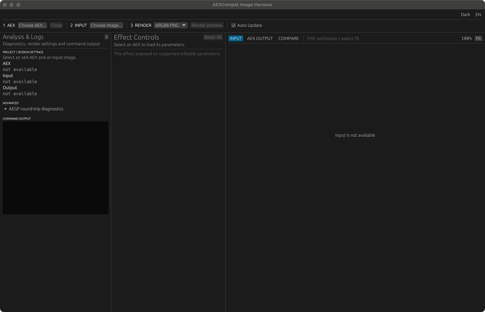

# AEXCompat

[日本語](README.md)

A tool for loading, rendering, and debugging After Effects `.aex` plug-ins without After Effects.

<p align="center">
  
</p>

- Pick an AEX, get its Effect Controls, render an image, and compare input and output
- Supports Classic Render, SmartFX, and ARGB8/16/32F
- Records why a plug-in stopped or crashed in a diagnostic log
- Applies several AEX in order as an [effect chain](docs/WINDOWS_GUI_EFFECT_CHAIN.md) (Windows)

## Try it

### Windows

Requires Windows 10/11 x64, Rust/Cargo, and Visual Studio or Build Tools (MSVC C++ and the Windows SDK).

```powershell
git clone https://github.com/onmokoworks/AEXCompat.git
cd AEXCompat\broker
cargo run -p aexcompat-harness
```

To render an AEX, also build the `minihost/` workers (needs CMake). See [Build Requirements](docs/BUILD_REQUIREMENTS.md).

### Apple Silicon Mac

Runs Windows x64 AEX under Unicorn emulation. Setup needs only Rust/Cargo.

```sh
git clone https://github.com/onmokoworks/AEXCompat.git
cd AEXCompat
tools/prepare-local-macos-aex-carriers.sh /tmp/aexcompat-local.dmg
```

To try your own AEX and PNG, pass absolute paths.

```sh
AEXCOMPAT_SMOKE_AEX=/absolute/path/to/effect.aex \
AEXCOMPAT_SMOKE_INPUT_PNG=/absolute/path/to/input.png \
  tools/prepare-local-macos-aex-carriers.sh /tmp/aexcompat-local-smoke.dmg
```

## Usage

1. Pick an AEX
2. Its Effect Controls appear
3. Set the input image and parameters
4. Press **Render current frame** or **Render and save PNG**
5. Compare input and output

Inputs can be PNG, JPEG, BMP, TIFF, or WebP; output is PNG. Multiple layers, time, downsampling, and mono float32 audio are also supported. See the [GUI guide](docs/GUI_GUIDE.md) for details.

## Limitations

- Unsupported Suites or effect-specific host assumptions can stop a plug-in
- A successful render does not guarantee the same image as After Effects
- Custom UI, GPU, pixel depth, and multiple inputs work for some AEX and not others
- Recreating all of After Effects or a full AEGP host is not a goal

## Development

```powershell
uv sync --locked
cargo test --manifest-path broker\Cargo.toml --workspace
uv run python -m pytest -q
```

| Directory | Contents |
|---|---|
| `broker/` | Rust broker and GUI |
| `minihost/` | C++ worker that runs the AEX |
| `guest/` | Worker that runs Windows x64 AEX on Apple Silicon |
| `instruments/` | AEX that measure SDK ABI and Suites |
| `tests/` | Tests |
| `analysis/` | Reference results from After Effects |

SDK-dependent tests and CI conditions are in [Build Requirements](docs/BUILD_REQUIREMENTS.md); contribution rules are in [Contributing](CONTRIBUTING.md). Do not post private or commercial AEX, the Adobe SDK, memory dumps, or personal file paths in issues or pull requests.

## Documentation

| Topic | Document |
|---|---|
| Build and CI | [Build Requirements](docs/BUILD_REQUIREMENTS.md) |
| Current compatibility | [Compatibility Status](docs/COMPATIBILITY_STATUS_2026-07-16.md) |
| Direction and roadmap | [Project Direction](docs/PROJECT_DIRECTION.md) |
| Results on macOS | [macOS Unicorn Corpus Metrics](docs/MACOS_UNICORN_CORPUS_METRICS.md) |
| Porting and analyzing an AEX | [AEX Porting Dossier](docs/aex-porting-dossier.md) |
| Safety of native Windows execution | [Windows Native Hardening Plan](docs/WINDOWS_NATIVE_HARDENING_PLAN_2026-07-16.md) |
| Capturing AE references on another machine | [AE Oracle Cross-Machine Runbook](docs/AE_ORACLE_CROSS_MACHINE_RUNBOOK_2026-07-18.md) |
| Public scope and third-party material | [Public Release Audit](docs/PUBLIC_RELEASE_AUDIT.md) |
| Reporting vulnerabilities | [Security Policy](SECURITY.md) |

More documents are listed in the [documentation index](docs/README.md).

## License

The parts owned by AEXCompat's developers are under the [Mozilla Public License 2.0](LICENSE). Third-party material, the Adobe SDK, and private AEX keep their own terms. Distribution terms for binaries that include Unicorn Engine are in [Public Release Audit](docs/PUBLIC_RELEASE_AUDIT.md).

Adobe, After Effects, and related product names are trademarks of their respective owners. This project is not affiliated with Adobe.
