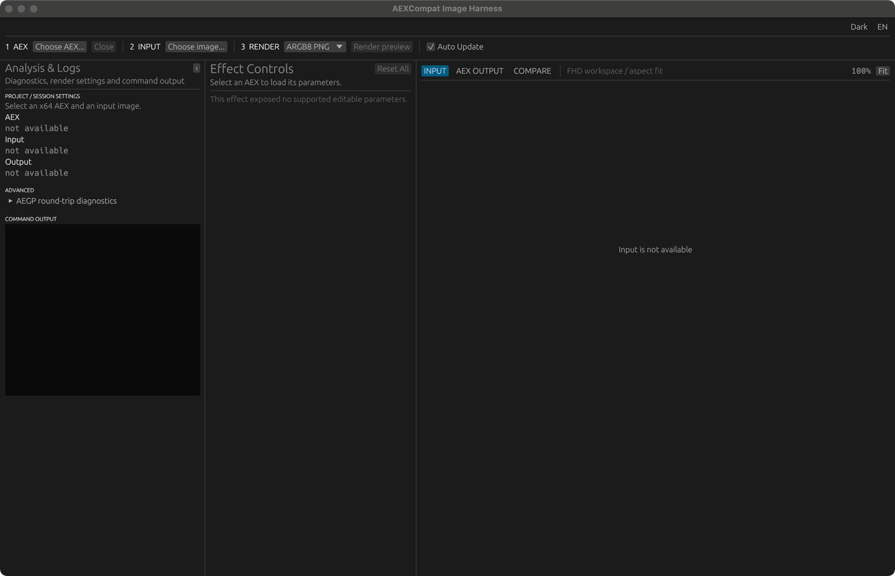

# AEXCompat

[English](README.en.md)

Windows x64用のAfter Effectsプラグイン（`.aex`）を、After Effectsなしで読み込んで描画・デバッグするためのツールです。

<p align="center">
  
</p>

- AEXを選ぶとEffect Controlsが出て、画像を入れて描画し、入力と出力を見比べられます
- Classic Render、SmartFX、ARGB8/16/32Fに対応しています
- 描画が止まったときや落ちたときの状況を、診断ログに残します
- 複数のAEXを順に掛ける[エフェクトチェーン](docs/GUI_GUIDE_JA.md#エフェクトを連続して適用する)も使えます

## 試す

### Windows

Windows 10/11 x64、Rust/Cargo、Visual StudioかBuild Tools（MSVC C++とWindows SDK）が必要です。

```powershell
git clone https://github.com/onmokoworks/AEXCompat.git
cd AEXCompat\broker
cargo run -p aexcompat-harness
```

AEXを読み込む・描画するには、`minihost/`のworkerもビルドします（CMakeが必要）。手順は[Build Requirements](docs/BUILD_REQUIREMENTS.md)にあります。

### Apple Silicon Mac

Windows x64のAEXを、Unicornでエミュレートして動かします。Rust/Cargo、Xcode Command Line Tools、CMakeが必要です（リポジトリのパスに空白やコロンを含めない）。次のコマンドで、arm64 workerのDMGをビルドして確かめられます。MacでGUIを動かす手順は[GUIガイド](docs/GUI_GUIDE_JA.md#apple-silicon-mac)にあります。

```sh
git clone https://github.com/onmokoworks/AEXCompat.git
cd AEXCompat
tools/prepare-local-macos-aex-carriers.sh /tmp/aexcompat-local.dmg
```

手元のAEXとPNGで試すときは、絶対パスで渡します。

```sh
AEXCOMPAT_SMOKE_AEX=/absolute/path/to/effect.aex \
AEXCOMPAT_SMOKE_INPUT_PNG=/absolute/path/to/input.png \
  tools/prepare-local-macos-aex-carriers.sh /tmp/aexcompat-local-smoke.dmg
```

## 使い方

1. AEXを選ぶ
2. Effect Controlsが出る
3. 入力画像とパラメーターを決める
4. **Render**を押す（Windowsは**Render preview**）
5. 入力と出力を見比べる

入力はPNG、JPEG、BMP、TIFF、WebP（MacのGUIは今のところPNGのみ）、8 bpcの出力はPNGです（16/32 bpcの保存形式はGUIガイドにあります）。複数レイヤーも使えます。時間とFPS、モノラルのfloat32音声、ダウンサンプル、ピクセルアスペクト比、シーケンス状態の検査は、今のところWindowsのGUIだけです。詳しい操作は[GUIガイド](docs/GUI_GUIDE_JA.md)にあります。

## できないこと

- 未対応のSuiteや、エフェクト固有のホストへの依存で止まることがあります
- 描画できても、After Effectsと同じ絵になるとは限りません
- カスタムUI、GPU、ピクセル深度、複数入力、シーケンス処理の扱いは、AEXによって動いたり動かなかったりします
- After Effects全体やAEGPホスト全体の再実装は目指していません

## 開発

```powershell
uv sync --locked
cargo test --manifest-path broker\Cargo.toml --workspace
uv run python -m pytest -q
```

| ディレクトリ | 中身 |
|---|---|
| `broker/` | Rust製のbrokerとGUI |
| `minihost/` | AEXを動かすC++ worker |
| `guest/` | Apple SiliconでWindows x64 AEXを動かすworker |
| `instruments/` | SDK ABIやSuiteを測るためのAEX |
| `tests/` | テスト |
| `analysis/` | After Effects実機の参照結果と検証記録 |

SDKを使うテストやCIの条件は[Build Requirements](docs/BUILD_REQUIREMENTS.md)、投稿のルールは[Contributing](CONTRIBUTING.md)にあります。非公開・市販のAEX、Adobe SDK、メモリダンプ、個人のファイルパスは、IssueやPRに載せないでください。

## 資料

| 内容 | 文書 |
|---|---|
| ビルドとCI | [Build Requirements](docs/BUILD_REQUIREMENTS.md) |
| いまの互換性 | [Compatibility Status](docs/COMPATIBILITY_STATUS_2026-07-16.md) |
| 方針とロードマップ | [Project Direction](docs/PROJECT_DIRECTION.md) |
| Macでの検証結果 | [macOS Unicorn Corpus Metrics](docs/MACOS_UNICORN_CORPUS_METRICS.md) |
| AEXの移植・解析 | [AEX Porting Dossier](docs/aex-porting-dossier.md) |
| Windowsネイティブ実行の安全性強化 | [Windows Native Hardening Plan](docs/WINDOWS_NATIVE_HARDENING_PLAN_2026-07-16.md) |
| 別のマシンでAE参照結果を取る | [AE Oracle Cross-Machine Runbook](docs/AE_ORACLE_CROSS_MACHINE_RUNBOOK_2026-07-18.md) |
| 公開範囲と第三者の成果物 | [Public Release Audit](docs/PUBLIC_RELEASE_AUDIT.md) |
| 脆弱性の報告 | [Security Policy](SECURITY.md) |

ほかの資料は[文書索引](docs/README.md)にあります。

## ライセンス

AEXCompatの開発者が権利を持つ部分は[Mozilla Public License 2.0](LICENSE)です。第三者の成果物、Adobe SDK、非公開AEXには、それぞれの条件が適用されます。Unicorn Engineを含む実行ファイルの配布条件は[Public Release Audit](docs/PUBLIC_RELEASE_AUDIT.md)にあります。

Adobe、After Effectsおよび関連製品名は各権利者の商標です。本プロジェクトはAdobe公式のものではありません。
